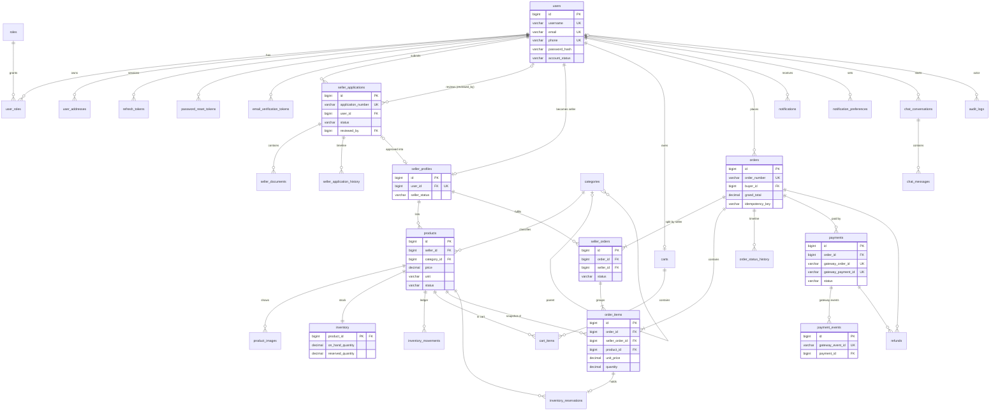

# FarmCrop database

MySQL 8.0 (developed against 8.0.46), database **`farmcrop`**, `utf8mb4` / `utf8mb4_0900_ai_ci`, InnoDB.
The schema is owned entirely by **Flyway** (`backend/src/main/resources/db/migration`); Hibernate only
validates it (`ddl-auto=validate`). All timestamps are stored in UTC as `DATETIME(6)`; money is
`DECIMAL(12,2)` (INR), agricultural quantities are `DECIMAL(12,3)`.

## Configuration (names only — values live in the git-ignored `backend/.env` or the environment)

| Variable | Purpose |
|---|---|
| `DB_HOST`, `DB_PORT`, `DB_NAME` | MySQL location (defaults `localhost`, `3306`, `farmcrop` in the dev profile) |
| `DB_USERNAME`, `DB_PASSWORD` | Application database account |
| `DB_POOL_MAX` | Optional HikariCP pool size (default 10) |
| `JWT_SECRET` | Access-token signing key (not stored in the database) |
| `FARMCROP_ADMIN_USERNAME`, `FARMCROP_ADMIN_EMAIL`, `FARMCROP_ADMIN_PASSWORD` | One-time first-admin bootstrap |

Create `backend/.env` with `powershell -ExecutionPolicy Bypass -File backend\scripts\new-local-env.ps1`.

## First-time setup (Windows PowerShell)

```powershell
$mysql = "C:\Program Files\MySQL\MySQL Server 8.0\bin\mysql.exe"
cd "C:\WD\A Project\FarmCrop"

# 1. Create the empty database (IF NOT EXISTS - never drops anything). Prompts for the password.
& $mysql -u root -p --table -e "source backend/scripts/create-database.sql"

# 2. Start the backend once: Flyway creates all tables and seeds reference data.
cd backend; .\mvnw spring-boot:run      # Ctrl+C after "Started FarmCropApplication"
cd ..

# 3. Verify (read-only report: tables, keys, indexes, CHECKs, Flyway history, integrity checks).
& $mysql -u root -p --table farmcrop -e "source backend/scripts/verify-schema.sql"
```

The application never creates databases (a mistyped `DB_NAME` fails fast). Flyway `clean` is disabled
and `baseline-on-migrate` is off, so Flyway can never drop objects or adopt an unknown schema.

### Recommended: a dedicated application account instead of `root`

Running the app as `root` means a single application bug or SQL-injection flaw would have full control
of every database on the server (including unrelated ones). Recommended least-privilege account
(create it yourself; it needs a password you choose, so it is not scripted):

```sql
CREATE USER 'farmcrop_app'@'localhost' IDENTIFIED BY '<choose a strong password>';
GRANT SELECT, INSERT, UPDATE, DELETE, CREATE, ALTER, INDEX, REFERENCES ON farmcrop.* TO 'farmcrop_app'@'localhost';
```

`CREATE, ALTER, INDEX, REFERENCES` are needed only for Flyway migrations; in production, run migrations
with a separate migration account and give the runtime account only `SELECT, INSERT, UPDATE, DELETE`.
Then set `DB_USERNAME=farmcrop_app` and its password in `backend/.env`.

## Migrations

| Version | Creates |
|---|---|
| V1 | `roles` (seeded BUYER/SELLER/ADMIN), `users`, `user_roles`, `user_addresses` |
| V2 | `refresh_tokens` |
| V3 | adds profile/verification/status columns to `users`; `password_reset_tokens`, `email_verification_tokens` |
| V4 | `seller_applications`, `seller_profiles`, `seller_documents`, `seller_application_history` |
| V5 | `categories` (8 seeded), `products`, `product_images` |
| V6 | `inventory`, `inventory_movements` |
| V7 | `carts`, `cart_items` |
| V8 | `orders`, `seller_orders`, `order_items`, `order_status_history`, `inventory_reservations` |
| V9 | `payments`, `payment_events`, `refunds` |
| V10 | `notifications`, `notification_preferences` |
| V11 | `chat_conversations`, `chat_messages` |
| V12 | `audit_logs` |

**31 application tables** (+ `flyway_schema_history`). Rules: never edit a migration once it has been
applied anywhere; add a new version instead. SQL must run on MySQL 8 and on H2 (MySQL mode), because the
automated tests execute the real migrations (see `.claude/skills/farmcrop-migrations/SKILL.md`).

## Tables

| Table | Purpose |
|---|---|
| `users` | Accounts. BCrypt hash only (`{bcrypt}` prefix); unique username/email/phone; `account_status` ACTIVE/SUSPENDED/DISABLED |
| `roles`, `user_roles` | BUYER (everyone), SELLER (admin approval only), ADMIN (bootstrap only); composite PK prevents duplicates |
| `user_addresses` | Buyer delivery addresses |
| `refresh_tokens` | SHA-256 hashes of rotating refresh tokens, grouped in families for reuse detection |
| `password_reset_tokens`, `email_verification_tokens` | Single-use tokens, stored hashed |
| `seller_applications` | Farmer applications (fields mirror the frontend form); status DRAFT→SUBMITTED→UNDER_REVIEW→APPROVED/REJECTED/RESUBMISSION_REQUIRED |
| `seller_documents` | Metadata + private storage key of verification documents (no binaries, no public URLs) |
| `seller_application_history` | Append-only review timeline |
| `seller_profiles` | One per approved seller; ACTIVE/SUSPENDED |
| `categories` | Crop categories (Organic is `products.organic`, not a category) |
| `products` | Listings owned by a seller profile; status DRAFT/ACTIVE/INACTIVE/OUT_OF_STOCK/UNDER_REVIEW/SUSPENDED/ARCHIVED; optional moderation flag |
| `product_images` | Public product photos (storage keys, ordering, primary flag) |
| `inventory` | One row per product: `on_hand_quantity`, `reserved_quantity`; CHECKs forbid negatives and over-reservation |
| `inventory_movements` | Append-only stock ledger with resulting balances |
| `carts`, `cart_items` | One cart per buyer; one line per product; not a reservation |
| `orders` | Buyer checkout: totals (CHECK: grand = subtotal + shipping − discount), delivery address snapshot, idempotency key |
| `seller_orders` | Per-seller fulfilment group inside an order (independent status, tracking) |
| `order_items` | Price/name/unit snapshots |
| `order_status_history` | Append-only order/fulfilment timeline |
| `inventory_reservations` | Stock held for unpaid order items; ACTIVE→CONSUMED/RELEASED/EXPIRED |
| `payments` | Razorpay order/payment ids (unique), amount, status, signature result. No card/UPI/bank data |
| `payment_events` | Webhook/verification events, unique per gateway event id (idempotency); payload hash only |
| `refunds` | Refund requests and gateway results |
| `notifications`, `notification_preferences` | Per-recipient in-app notifications; channel preferences |
| `chat_conversations`, `chat_messages` | Buyer/seller assistant history; no API keys stored |
| `audit_logs` | Append-only admin/sensitive action trail (no secrets or document contents) |

## Relationships and delete behaviour

- `ON DELETE CASCADE` is used only for data that belongs exclusively to a user and has no business
  history: tokens, addresses, cart, notifications, preferences, chat.
- Everything with business or financial history (applications, products, orders, payments, refunds,
  audit logs, inventory ledger) uses the default **RESTRICT**: a user or product with history cannot be
  deleted; it is deactivated/archived instead. Products are never physically deleted.



## Development vs test databases

- **Development**: local MySQL `farmcrop` (profile `dev`). Never used by automated tests.
- **Automated tests**: isolated in-memory H2 in MySQL mode (profile `test`), created fresh per run from the
  same Flyway migrations. `SchemaIntegrityTest` asserts the exact table set, migration history and the
  database-level constraints (negative stock, over-reservation, totals, duplicates, protected history).

## Backup and restore

```powershell
$dump = "C:\Program Files\MySQL\MySQL Server 8.0\bin\mysqldump.exe"
# Backup (prompts for the password). Store dumps outside the repository: they contain personal data.
& $dump -u root -p --single-transaction --routines --triggers --set-gtid-purged=OFF farmcrop --result-file="$env:USERPROFILE\Backups\farmcrop-$(Get-Date -Format yyyyMMdd-HHmm).sql"
# Restore into an EMPTY database only (never over a live one without a fresh backup).
& $mysql -u root -p farmcrop -e "source C:/Users/<you>/Backups/farmcrop-YYYYMMDD-HHMM.sql"
```

Never commit dumps to Git.
